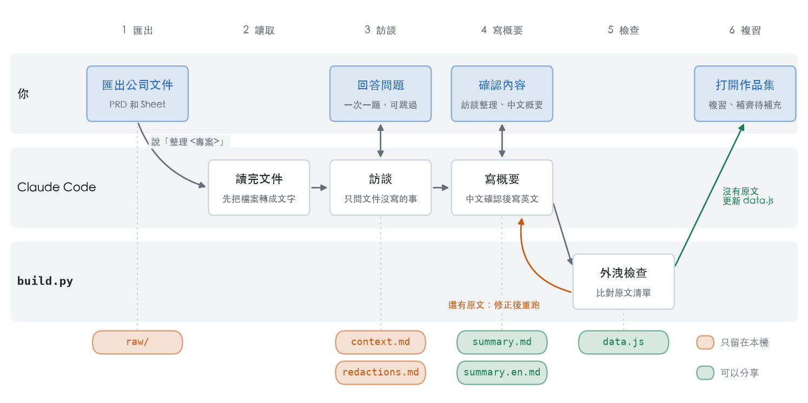

# 專案作品集整理器

把在公司做過的專案整理成面試用的中英文概要，並在一個網頁裡瀏覽、複習。

你只要做兩件事：把公司文件匯出放進資料夾，然後回答 Claude Code 的問題。讀文件、寫概要、去敏感化、更新網頁，都由 Claude Code 完成。

## 整個流程

<picture>
  <source media="(prefers-color-scheme: dark)" srcset="docs/images/workflow-dark.png">
  
</picture>

每一欄是一個階段，每一列是誰在做事。下方的檔案顯示每一步寫出什麼：橘色的只能留在這台電腦，不分享、不同步；綠色的已經去敏感化，可以帶出去。兩種都不會進 git，見「安全提醒」。圖由 `docs/figures/workflow.py` 產生。

## 1. Setup

只需要做一次。

1. **確認有 Python 3**。打開「終端機」，輸入：

   ```bash
   python3 --version
   ```

   看到 `Python 3.9` 或更新的版本就可以了。如果跳出安裝視窗，或顯示找不到指令，用下面任一種方式安裝：

   ```bash
   xcode-select --install
   ```

   ```bash
   brew install python
   ```

   不需要安裝任何 Python 套件。

2. **確認 Claude Code 可以用**。在這個資料夾裡開啟 Claude Code（終端機執行 `claude`，或用桌面版 app 開啟這個資料夾）。它會自動讀取 `AGENTS.md` 裡的工作規則。

3. **放對位置**。不要把這個資料夾放在 iCloud Drive（包括有開同步的「桌面」和「文件」）、Dropbox、Google Drive 這類會自動同步的地方，否則公司文件會被上傳到雲端。建議放在家目錄底下，例如 `~/ni-project-portfolio`。

## 2. 匯出公司文件

**離職後公司帳號就會被關掉，請在離職前完成這一步。**

每個專案建一個資料夾，把文件放進它的 `raw/`：

```
projects/
  member-tier-revamp/     ← 專案資料夾，用英文小寫加連字號命名
    raw/
      prd.pdf
      metrics.xlsx
      prototype.html
```

資料夾名稱會顯示在作品集裡，不要用客戶名稱或內部代號，例如用 `insurer-crm`，不要用 `cathay-crm`。

- **Google Doc（PRD）**：檔案 → 下載 → PDF 文件 (.pdf)。
- **Google Sheet**：檔案 → 下載 → Microsoft Excel (.xlsx)。不要選 CSV，CSV 只會帶走目前那一個分頁。
- **HTML 檔**：直接複製進來。
- Word 檔（.docx）也可以放，Claude Code 會自己轉成文字。

## 3. 整理一個專案

在這個資料夾開啟 Claude Code，跟它說：

```
整理 member-tier-revamp
```

接下來它會：

1. 讀完 `raw/` 裡的文件，告訴你讀到什麼。
2. 一題一題問你文件裡沒寫的事：你的角色、最後結果、最難的決策等。不記得可以回「跳過」或「不記得」。
3. 遇到客戶名稱、金額這類敏感資訊，問你要怎麼代稱。
4. 寫出中文概要給你確認，再寫英文版。
5. 更新網頁。

之後補充內容或改了概要，跟它說「更新 member-tier-revamp」就好。

想看完整的範例，打開 `projects/_example/`。它是虛構的專案，不會出現在你的作品集裡。

## 4. 看作品集

在 Finder 裡雙擊 `portfolio.html`，建議用 Chrome 或 Safari 開。

- 左邊是專案清單，「缺 N 項」表示還有幾個地方待補充。
- 螢幕夠寬時，右邊會有一欄「本頁」段落導覽和「待補充」清單，點一下就會跳到那個位置。
- 右上角可以切換中文和英文。
- 黃色標籤是待補充的地方；淡紫色底的字是去敏感化替換過的詞，滑鼠移上去會顯示「已替換」。
- 每個專案最後的「面試追問」排成問答卡，先看問題自己回答一遍，再看下面的回答重點。

網頁內容是從 `data.js` 來的，它由 `build.py` 產生、不在 git 裡。第一次打開時如果看到「找不到 data.js」，或你自己改了概要、網頁沒有更新，請 Claude Code 跑一次 build，或在終端機執行：

```bash
python3 build.py
```

## 5. 安全提醒

- **可以帶出去或分享的**：`portfolio.html`、`data.js`、各專案的 `summary.md` 和 `summary.en.md`。
- **只能留在這台電腦的**：
  - 各專案的 `raw/`：公司原始文件；
  - 各專案的 `context.md`：訪談原話，沒有去敏感化；
  - `redactions.md`：敏感詞的原文清單。
- `build.py` 會檢查概要裡有沒有殘留 `redactions.md` 裡的原文，有的話會拒絕更新網頁，並告訴你是哪一行。
- `projects/` 裡的所有東西（包括概要）和 `redactions.md` 都不會進 git，`.gitignore` 已經排除；不要用 `git add -f` 強制加入。
- **所以請自己備份概要**：定期把各專案的 `summary.md`、`summary.en.md` 複製到隨身碟或你自己的雲端資料夾。不要備份 `raw/`、`context.md`、`redactions.md`。
- 公司對帶走文件的規定，請自己確認。
